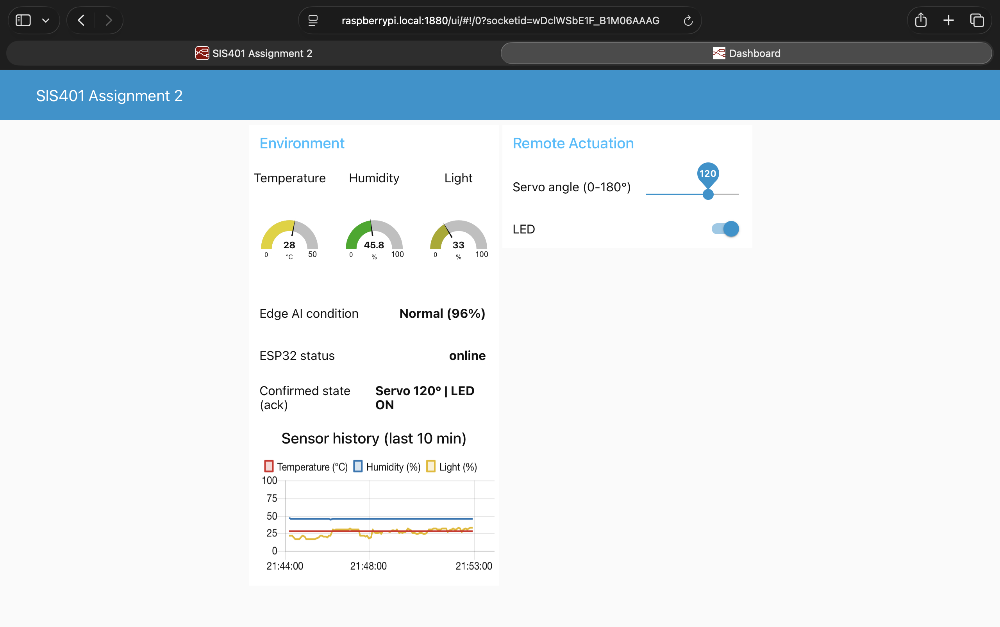
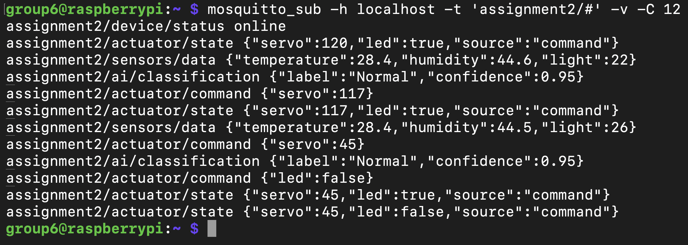
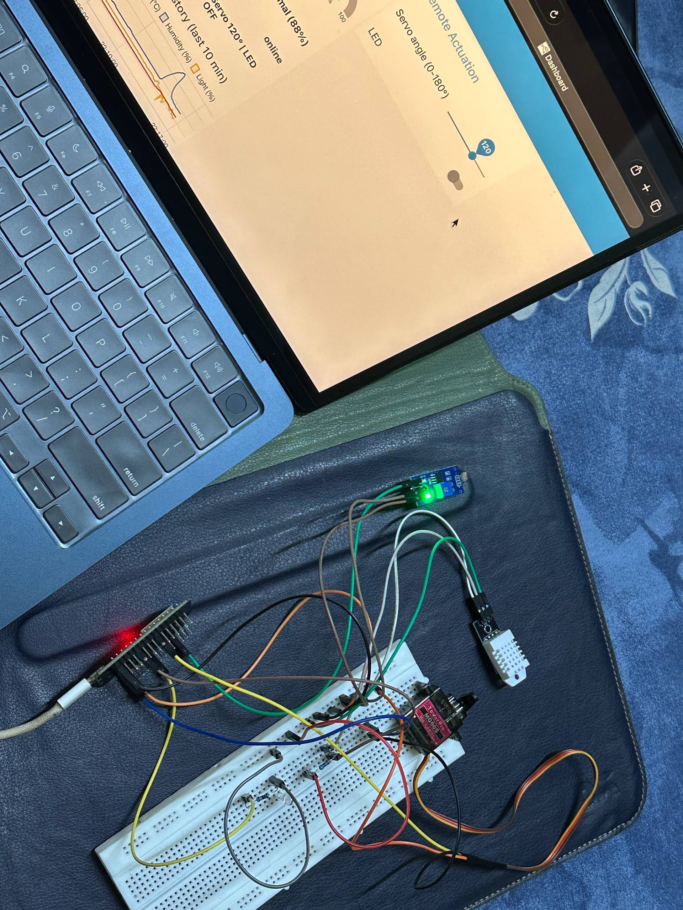
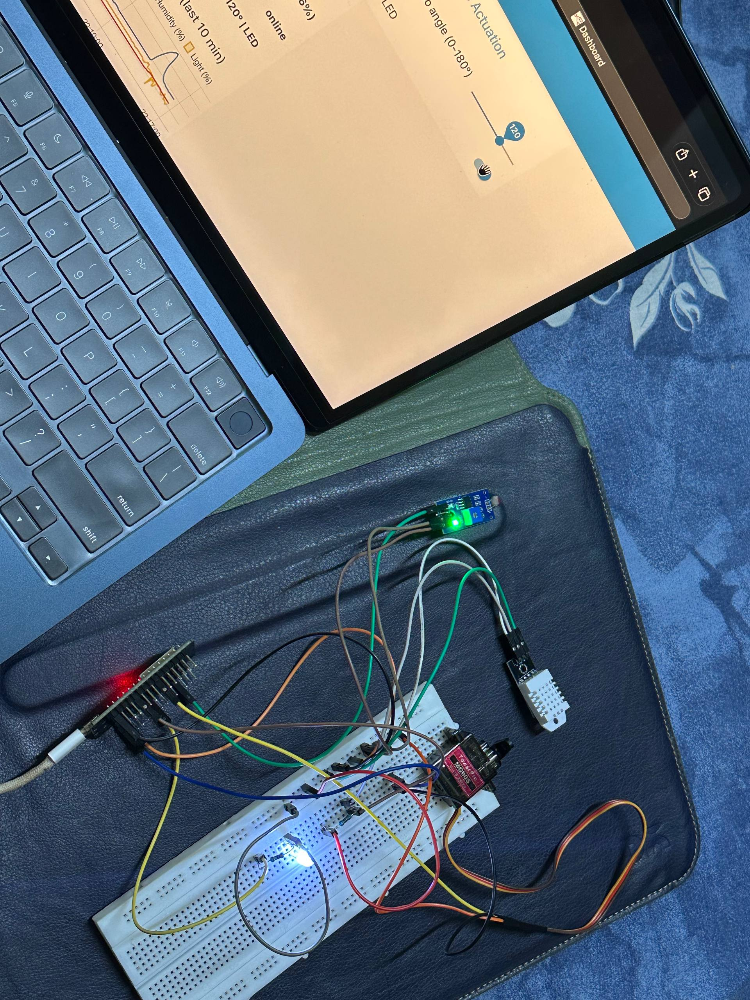
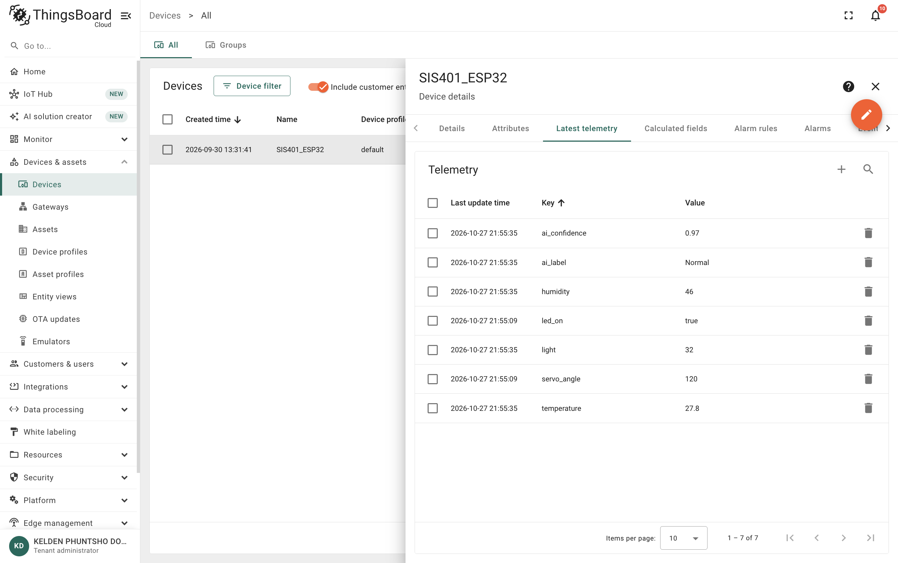
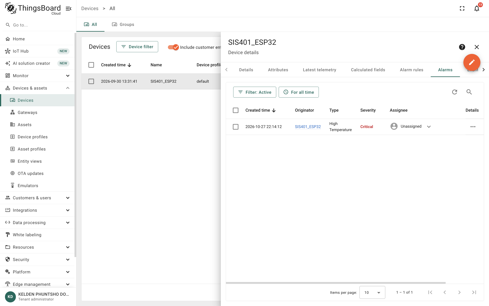
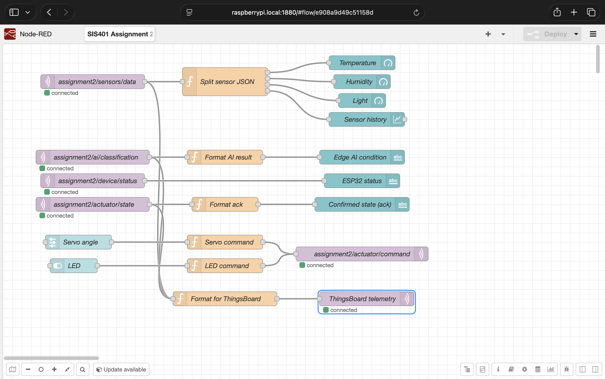
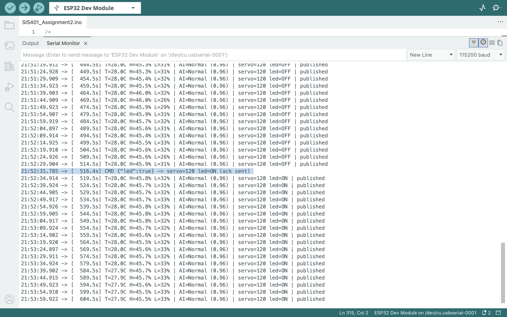

# SIS401 Assignment 2 - IoT Data Pipeline

**Group 6** · Student Nos: 02230285, 02230281, 02230299, 02230300
**Module:** SIS401 Smart Integrated Systems

An end-to-end IoT pipeline. An ESP32 reads two sensors, runs an Edge AI
classifier on the readings, and publishes everything over MQTT to a Mosquitto
broker on a Raspberry Pi. Node-RED on the Pi shows the data on a live
dashboard, forwards it to ThingsBoard Cloud where an alarm rule watches the
temperature, and sends servo and LED commands back to the ESP32, which
acknowledges each one on its own topic.



## System architecture

```
 DHT22 ─┐                                       ┌──► Node-RED dashboard (/ui)
 LDR  ──┼─► ESP32 ──MQTT──► Mosquitto (Pi) ─────┤
        │     │  Edge AI                         └──► ThingsBoard Cloud
 Servo ◄┤     │  (Edge Impulse)                        telemetry + alarm rule
 LED   ◄┘     └──◄── assignment2/actuator/command ◄── dashboard slider / switch
```

| Part | Choice |
|---|---|
| Microcontroller | ESP32 DevKit |
| Sensors | DHT22 (temperature, humidity) - digital; LDR module (light) - analog |
| Actuators | MG90S servo, LED |
| Broker | Mosquitto 2.0 on Raspberry Pi 4 |
| Dashboard | Node-RED 5 + node-red-dashboard |
| Cloud platform | ThingsBoard Cloud, MQTT with device access token |
| Edge AI | Edge Impulse neural network running on the ESP32 |

## MQTT topics

| Topic | Direction | Payload |
|---|---|---|
| `assignment2/sensors/data` | ESP32 → broker, every 5 s | `{"temperature":28.4,"humidity":44.6,"light":22}` |
| `assignment2/ai/classification` | ESP32 → broker, every 5 s | `{"label":"Normal","confidence":0.95}` |
| `assignment2/actuator/command` | dashboard → ESP32 | `{"servo":45}` or `{"led":false}` |
| `assignment2/actuator/state` | ESP32 → broker (retained) | `{"servo":45,"led":false,"source":"command"}` |
| `assignment2/device/status` | ESP32 → broker (retained, last will) | `online` / `offline` |

Commands and acknowledgements are kept on separate topics. The ESP32 only
publishes to `actuator/state` after the actuator has moved, so the dashboard's
"Confirmed state" shows what the hardware actually did rather than what was
requested. The status topic uses MQTT's last-will message, so the broker marks
the ESP32 `offline` automatically if it drops off the network.



## Extensions beyond Practicals 5 and 6

- **JSON payloads** in both directions instead of one plain value per topic,
  parsed with ArduinoJson; malformed commands are rejected and logged.
- **Acknowledgement topic** with the confirmed state, retained so a dashboard
  opened later still shows the current state.
- **Last-will device status** so the dashboard shows when the ESP32 goes offline.
- **Two actuators** on one command topic, each optional in the payload.
- **Non-blocking reconnection**: MQTT is retried every 5 s without stalling sensing.
- **Gradual servo movement** (1° steps) to limit the motor's start-up current,
  which otherwise browned out the shared USB supply.
- **Cloud forwarding from the gateway**: Node-RED maps local topics to flat
  ThingsBoard telemetry keys, so the ESP32 only ever talks to the local broker.
- **Edge AI** classification published and displayed alongside the sensor data.

## Circuit

| Component pin | Connected to | Notes |
|---|---|---|
| DHT22 VCC | ESP32 3.3 V | |
| DHT22 DATA | ESP32 GPIO 4 | 10 kΩ pull-up to 3.3 V |
| DHT22 GND | ESP32 GND | |
| LDR VCC | ESP32 3.3 V | |
| LDR AO | ESP32 GPIO 34 | ADC input only; DO not used |
| LDR GND | ESP32 GND | |
| Servo signal (orange) | ESP32 GPIO 18 | PWM |
| Servo VCC (red) | ESP32 VIN (5 V) | |
| Servo GND (brown) | ESP32 GND | common ground |
| LED anode (long leg) | ESP32 GPIO 26 | through 220 Ω |
| LED cathode | ESP32 GND | |

The Raspberry Pi must be powered from its own 5 V 3 A supply, not from the
same laptop or USB hub as the ESP32. During testing the servo's start-up
current on the shared supply reset the Pi.

| LED off | LED on (switched from the dashboard) |
|---|---|
|  |  |

## Cloud platform: ThingsBoard

- Device `SIS401_ESP32`, authenticated with its MQTT **access token**.
- Node-RED publishes to `v1/devices/me/telemetry` on `mqtt.thingsboard.cloud`.
- Telemetry keys: `temperature`, `humidity`, `light`, `ai_label`,
  `ai_confidence`, `servo_angle`, `led_on`.
- **Alarm rule** `High Temperature`: severity **Critical** when
  `temperature > 30`, cleared when `temperature <= 30`.





## Edge AI extension

| Item | Detail |
|---|---|
| Model type | Fully connected neural network (2 inputs → 20 → 10 → 3 classes), quantized int8 |
| Platform | Edge Impulse, exported as an Arduino library (TensorFlow Lite for Microcontrollers, EON Compiler) |
| Classes | Cold-Humid, Hot-Dry, Normal |
| Inputs | temperature / 50 and humidity / 100 from the DHT22 |
| Training data | 900 labelled samples (300 per class) generated across the temperature and humidity range of each class, replacing the 30-sample dataset of the shared tutor project |
| Accuracy | 97.2 % on the validation set (the original 30-sample model scored 40 %) |
| On-device cost | about 1 ms per inference, 1.4 KB RAM |

The label and confidence are published to `assignment2/ai/classification`,
shown on the dashboard and forwarded to ThingsBoard as `ai_label` and
`ai_confidence`.

## Repository contents

| Path | Purpose |
|---|---|
| `SIS401_Assignment2/SIS401_Assignment2.ino` | ESP32 firmware |
| `node-red/a2_flow.json` | Node-RED flow: dashboard, commands, cloud forwarding |
| `dashboard_screenshot.png` | Node-RED dashboard with live data |
| `cloud_screenshot.png` | ThingsBoard device telemetry |
| `docs/` | Flow, serial monitor, MQTT subscriber, alarm and hardware evidence |
| `REFLECTION.md` | Reflection on the work |

WiFi details, the broker IP and the ThingsBoard access token are not
committed. Fill them in as described below.

## Setup

### 1. Raspberry Pi: broker and Node-RED

```bash
sudo apt install -y mosquitto mosquitto-clients
printf 'listener 1883\nallow_anonymous true\n' | sudo tee /etc/mosquitto/conf.d/lan.conf
sudo systemctl enable --now mosquitto
bash <(curl -sL https://raw.githubusercontent.com/node-red/linux-installers/master/deb/update-nodejs-and-nodered) --confirm-install --confirm-pi --no-init
sudo systemctl enable --now nodered.service
cd ~/.node-red && npm install node-red-dashboard && sudo systemctl restart nodered.service
hostname -I
```

If the network is an iPhone hotspot, turn on **Maximize Compatibility** so
both the Pi and the ESP32 can join (2.4 GHz, WPA2).

### 2. ThingsBoard Cloud

1. Create a device (here `SIS401_ESP32`) and copy its **access token**.
2. On the device, open **Alarm rules** and add `High Temperature`:
   argument `temperature` (latest telemetry), trigger **Critical** when
   `greater than 30`, clear when `less or equal 30`.

### 3. Node-RED flow

1. Open `http://<pi-ip>:1880` → ☰ → Import → `node-red/a2_flow.json`.
2. Double-click **ThingsBoard telemetry** → edit the **ThingsBoard Cloud**
   broker → Security → paste the access token as **Username**, leave the
   password empty.
3. Deploy. The dashboard is at `http://<pi-ip>:1880/ui`.



### 4. ESP32 firmware

1. Install libraries in the Arduino IDE: DHT sensor library, Adafruit Unified
   Sensor, PubSubClient, ArduinoJson (v7), ESP32Servo.
2. Add the Edge Impulse library: Sketch → Include Library → Add .ZIP Library
   → `SIS401_Environment_Classifier_inferencing.zip`.
3. In `SIS401_Assignment2.ino`, set `WIFI_SSID`, `WIFI_PASSWORD` and
   `MQTT_BROKER` (the Pi's IP).
4. Board **ESP32 Dev Module**, upload, and open the Serial Monitor at 115200.



### 5. Verify

```bash
mosquitto_sub -h <pi-ip> -t 'assignment2/#' -v
```

Moving the dashboard slider or switch produces a command and, a moment later,
the matching acknowledgement on `assignment2/actuator/state`.